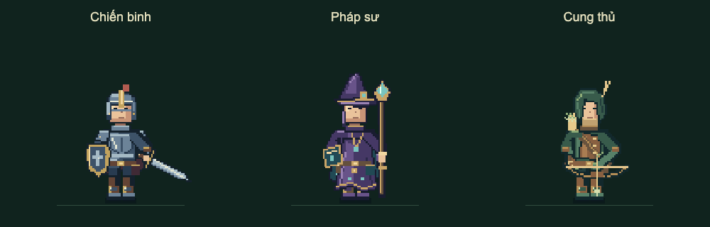

# Nhân vật ba class — bản dựng chi tiết

Ngày cập nhật: 19/11/2026. Đã tích hợp trong menu chọn class, danh sách nhân vật và map tại `/?view=game`.



- Chiến binh: giáp thép có viền sáng, giáp vai, đai và túi da, áo choàng đỏ; mũ có sống/crest khi mặc helmet, găng giáp và khiên khi trang bị đúng ô.
- Pháp sư: áo tím nhiều lớp, viền vàng và họa tiết, áo choàng xanh, mũ nhọn, trượng pha lê; tay phụ có sách phép khi trang bị.
- Cung thủ: mũ trùm xanh, khăn cổ, áo da và đai chéo, bao tên sau lưng; cung có dây kéo/thả, bao tên lớn hơn khi có tay phụ.

Bốn hướng được vẽ riêng mặt trước, sau và hông; hướng trái dùng phản chiếu ngang. Không xoay toàn bộ người để thay cho nhìn lên/xuống. Hình thể được dựng trên lưới khoảng 48 × 64 px, có phần mũ/vũ khí vượt thân trong frame có đệm 112 × 88. Hiển thị ở tỉ lệ 0,78 để khớp cây/quái/VFX trong map, giữ anchor tại chân.

## Chuyển động và trang bị

Có đứng thở/áo choàng đung đưa, đi, chạy, đánh kiếm, khiên kích, niệm phép, kéo/thả cung, né, trúng đòn, ngã và hồi sinh. Đòn đánh có lấy đà ngắn, ra đòn và thu thế. Pháp sư giữ sách bên tay phụ khi niệm phép; khi không cầm sách có cử chỉ tay tự do. Khi trúng đòn giữa một đòn đánh, nhân vật lóe sáng mà không cắt ngang động tác.

Animation chạy 12 khung/giây, xuất phát từ sự kiện cast/hurt/dodge/death/respawn và snapshot server. Tốc độ chạy được nhận từ chuyển vị server; pause dừng animation cùng khung cảnh. Khi kết nối lại với HP bằng 0, nhân vật hiện tư thế đã ngã thay vì phát lại động tác chết từ đầu.

Các phần vũ khí, áo, giày, mũ, găng và tay phụ dựa trên ô đang mặc. Khi tháo vũ khí/giáp, hình tương ứng biến mất hoặc trở về lớp áo trong. Đây là ngoại hình bậc 1 theo class/slot; chưa phải bộ skin cho mọi tier của kế hoạch cấp 1–50.

Phần nâng cấp này nằm ở client. Điểm chân, va chạm, tầm đánh, damage, XP, save và cooldown vẫn theo dữ liệu server hiện tại. Đạn hiển thị cao hơn 9 px để khớp tay cầm/cung; tọa độ mô phỏng và phép kiểm trúng đòn giữ nguyên.

## Xem và tái tạo preview

- [Video chuyển động WebM](art/characters/motion.webm).
- [Bốn hướng](art/characters/directions.png).
- [Chiến binh](art/characters/warrior-motion.png), [pháp sư](art/characters/mage-motion.png), [cung thủ](art/characters/archer-motion.png).

Khi server local đang chạy:

```sh
node scripts/preview-avatars.mjs review --video
```

Kết quả trong `records/avatars/review/` (Git bỏ qua). Script dùng module avatar thật qua trình duyệt và MediaRecorder; không cần ffmpeg. Mặc định Chrome có sẵn; `CI=1` dùng Chromium Playwright đã cài. Có thể đổi origin bằng `AVATAR_PREVIEW_URL`.

Đã thực hiện các vòng render/xem/chỉnh: silhouette/trang phục → lấy đà, tay mở sách và chu kỳ áo → đầu gối/gấu áo khi né → lớp vũ khí khi quay lưng và cổ áo. Mẫu chuyển động tham khảo là `melee/sword-slash` qua `tools/act.mjs` của PixelFX. Avatar là Canvas riêng nên kiểm bằng motion/browser tests, không ghi nhận `tools/check.mjs` cho một FX module không tồn tại.

## Kiểm thử

- **51 test Node đạt**: gồm 7 test motion/appearance mới và hồi quy rules, combat, auth, PostgreSQL/recovery. [Log](art/characters/node-tests.txt).
- **9 test browser đạt**: gồm 1.056 tổ hợp frame/hướng/trạng thái không chạm biên sprite, trang bị thay đổi pixel; portrait chuyển động trong menu; reconnect nhân vật chết/hồi sinh; gameplay ba class, mobile giả lập và thư viện asset. [Log](art/characters/browser-tests.txt); [retest visual cuối](art/characters/visual-retest.txt).
- `npm run check` và `git diff --check` đạt.

Đã xem trên desktop và viewport mobile giả lập. Điện thoại vật lý và nghiệm thu đầy đủ hitbox/VFX ở mọi hướng vẫn thuộc các cổng visual/performance của sprint.

Mã nguồn: [avatar.js](../game/client/avatar.js), [avatar-motion.js](../game/client/avatar-motion.js), [renderer.js](../game/client/renderer.js). Khung hình vẽ được cache có giới hạn 256 mục; portrait cập nhật 12 Hz.
