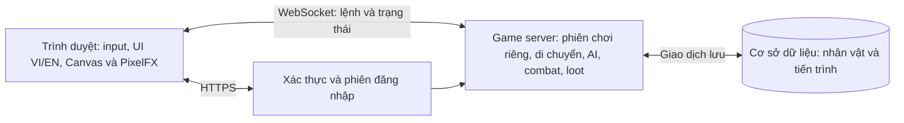

# Kế hoạch game: Dấu Ấn Rừng Đêm / Nightwood Sigils

Ngày lập: 19/11/2026. Trạng thái: **thiết kế toàn bộ game 1–50**. Build local hiện tích hợp tính năng S01–S03 tới cấp 5; phần còn lại vẫn là kế hoạch. Xem [README](../README.md) và [báo cáo S03](test-reports/S03.md) cho phạm vi thực tế và cổng còn mở.

Lựa chọn đã xác nhận: **chơi đơn trên web, có tài khoản và lưu online**. Tiếng Việt mặc định; có tiếng Anh. Không gian chơi là bản đồ riêng cho từng người chơi.

## 1. Phạm vi và định hướng

- Thể loại: ARPG pixel art, khám phá bản đồ, chiến đấu thời gian thực và phát triển nhân vật.
- Góc nhìn: top-down 3/4 cố định, nối tiếp khu rừng đang có; không xoay camera.
- Bản đầy đủ đầu tiên: cấp 1–50, 3 class, 10 map chiến đấu, 10 boss, một khu an toàn dùng chung hệ thống nhưng riêng phiên chơi.
- Mỗi tài khoản có 3 ô nhân vật, đủ tạo Chiến binh, Pháp sư và Cung thủ. Tiến trình, trang bị, tiền và nhiệm vụ tách riêng từng nhân vật; ngôn ngữ thuộc tài khoản.
- Vòng chơi: nhận nhiệm vụ → khám phá → đánh quái → nhặt đồ → tăng cấp/nâng kỹ năng → đánh boss → mở map tiếp.
- Bản đầu tập trung PvE chơi đơn. Co-op, PvP, giao dịch giữa tài khoản, bang hội và thị trường không nằm trong đợt này.
- Mục tiêu hành trình đầu: khoảng 12–18 giờ tới cấp 50. Đây là mục tiêu trải nghiệm cần đo khi chơi thử, không phải thời gian đã được chứng minh.

Tài liệu đi kèm:

- [Sprint triển khai và kiểm thử](SPRINT_PLAN.md): 9 sprint hai tuần, đầu ra, dependency, tiêu chí qua mốc và lịch chuẩn bị asset.
- [Backlog 54 đầu việc](game-design/sprint-backlog.csv) và [72 test case dự kiến](game-design/test-cases.csv), hiện đều chưa thực hiện.
- [Bảng từng cấp 1–50](game-design/progression-1-50.csv): XP, thời điểm mục tiêu, map, vũ khí từng class, bậc đồ, ô trang bị và mốc kỹ năng. CSV UTF-8 có BOM để mở tiếng Việt trong bảng tính.
- [Dữ liệu cân bằng đề xuất](game-design/balance-draft.json): ID, tên Việt/Anh, class, map, 18 kỹ năng, 10 bậc trang bị và công thức. File này chưa được game hiện tại sử dụng.

## 2. Tận dụng những gì đã có

Đã kiểm tra phiên bản local `pixelfx/`: **244 hiệu ứng, 21 nhóm, 12 loại critter**; mốc upstream `a84159688af3ca37a4be05a0d422b94451b2e24e`. Không giả định nội dung của những phiên bản upstream khác.

| Hạng mục | Hiện có | Việc còn lại |
|---|---|---|
| Map đầu | Rừng 1536 × 1024, 34 cây, hồ, đường mòn, camera, tìm đường, va chạm | Khu an toàn, điểm sinh quái, cổng, NPC, nhiệm vụ và arena boss |
| Không khí | `weather/fireflies`, `fog`, `rain`, `snow`, `blizzard`, `storm` | Chọn palette, cường độ và vị trí phù hợp từng biome |
| Cận chiến | `melee/*`, `impacts/*`, các move mẫu | Animation nhân vật, hướng đánh và vùng trúng đòn thực tế |
| Phép thuật | `fire/*`, `ice/*`, `lightning/*`, `arcane/*`, `holy/*`, `shadow/*` | Mana, hồi chiêu, mục tiêu, tầm đánh và trạng thái |
| Quái | Slime, bat, frog, snake, ghost, eyeball, flying skull, wisp, jellyfish… | AI, animation báo đòn/chịu đòn/chết, hitbox và biến thể theo biome |
| Phần thưởng | `pickups/*`, `ui/level-up`, `ui/quest-complete`, `ui/damage-number` | Túi đồ, vật phẩm thật, bảng rơi đồ và lưu server |
| Nhân vật | Hình nhân/rig của PixelFX; nhân vật thử nghiệm trên map | Ba ngoại hình class hoàn chỉnh, vũ khí, bộ động tác và icon kỹ năng |

**Phân biệt hình ảnh với gameplay:** critter hiện có thường tự bay/di chuyển theo vòng lặp trình diễn; chưa tự tìm mục tiêu hoặc chiến đấu. Move mẫu có mục tiêu và thời gian dựng sẵn; không dùng nguyên chuỗi demo để quyết định sát thương.

Ví dụ Hỏa Cầu: dùng `fire/fireball` cho đạn và một vụ nổ ở điểm chạm; gameplay có thời gian niệm khoảng 0,25 giây. Không bắt người chơi chờ toàn bộ demo `moves/fireball-throw` dài 6,81 giây.

## 3. Hai ngôn ngữ

- Locale: `vi`, `en`; lần vào đầu luôn là `vi`, kể cả trình duyệt đang dùng tiếng Anh.
- Có công tắc **Tiếng Việt / English** ở màn hình vào game và Cài đặt; đổi trực tiếp, giữ nguyên tiến trình và vị trí.
- Lưu lựa chọn vào hồ sơ tài khoản; trước đăng nhập có thể nhớ trên thiết bị. Thiết bị khác lấy ngôn ngữ từ tài khoản sau đăng nhập.
- Dịch toàn bộ phần người chơi nhìn thấy: đăng ký/đăng nhập, class, map, quái, kỹ năng, vật phẩm, chỉ số, nhiệm vụ, hội thoại, hướng dẫn, thông báo lỗi và trạng thái lưu/kết nối.
- Dùng ID ổn định như `mage.fireball`, `firefly-woods`, `item.novice-sword`; không dùng tên đã dịch làm khóa dữ liệu hoặc save.
- Tách `locales/vi.json` và `locales/en.json`. Không ghép câu từ những đoạn dịch rời; dùng biến `{amount}`, `{level}`, `{name}` và định dạng số theo locale.
- Font phải có đủ dấu tiếng Việt; kiểm tra chữ Đ/đ, ă/â/ê/ô/ơ/ư và các dấu thanh. Chừa không gian cho câu tiếng Anh dài hơn.
- Nếu thiếu bản dịch, bản phát triển báo key thiếu; bản phát hành dùng tiếng Việt dự phòng. Cổng phát hành yêu cầu không còn key thiếu ở cả hai locale.

Ví dụ:

| Key | Tiếng Việt | English |
|---|---|---|
| `class.warrior` | Chiến binh | Warrior |
| `skill.mage.fireball` | Hỏa Cầu | Fireball |
| `progress.levelUp` | Bạn đã đạt cấp {level}! | You reached level {level}! |
| `save.saved` | Đã lưu tiến trình | Progress saved |
| `connection.interrupted` | Mất kết nối. Đang kết nối lại… | Connection lost. Reconnecting… |
| `item.requiresLevel` | Yêu cầu cấp {level} | Requires level {level} |

## 4. Ba class

| Class | Vai trò và cách chơi | Vũ khí / tay phụ | HP / MP / Power / Giáp ban đầu |
|---|---|---|---|
| Chiến binh / Warrior | Cận chiến, chịu đòn, choáng và đánh nhiều mục tiêu gần | Kiếm / khiên | 160 / 60 / 12 / 8 |
| Pháp sư / Mage | Đánh xa, phép diện rộng, khống chế; cần quản lý mana và vị trí | Trượng / pháp thư | 105 / 140 / 14 / 3 |
| Cung thủ / Archer | Đánh xa cơ động, xuyên mục tiêu, độc và chí mạng | Cung / ống tên | 125 / 90 / 12 / 5 |

Mỗi lần lên cấp, cộng tự động:

| Class | HP | MP | Power | Giáp |
|---|---:|---:|---:|---:|
| Chiến binh | +14 | +3 | +2 | +0,8 |
| Pháp sư | +9 | +8 | +2 | +0,45 |
| Cung thủ | +11 | +5 | +2 | +0,6 |

Power là sức mạnh tấn công của class: vật lý cho Chiến binh/Cung thủ, phép cho Pháp sư. Bản đầu tăng chỉ số tự động để tránh tạo thêm một hệ phân điểm khó cân bằng; lựa chọn build nằm ở kỹ năng và trang bị.

Đánh thường không tốn mana, tách khỏi 6 kỹ năng có thể nâng cấp. Né cơ bản dùng stamina chung; không tiêu mana. Hồi stamina và mana không phụ thuộc vào class đang gây được sát thương hay không, để người chơi luôn có cách tiếp tục đánh.

Điều khiển dự kiến: WASD/phím mũi tên di chuyển, chuột chọn hướng và đánh thường, phím 1–4 dùng kỹ năng, Space né, Shift đi nhanh có tiêu stamina. Điện thoại có cần/nút hướng bên trái, đánh thường và bốn nút kỹ năng bên phải; chạm chọn mục tiêu. Có cấu hình lại phím và chỉ báo tầm đánh.

Nhân vật dùng kích thước gốc khoảng 24 × 38 px, phù hợp thang đo PixelFX. Đi/đứng có 4 hướng; ngắm và đánh hỗ trợ 8 hướng. Đạn có thể quay theo hướng bắn; không xoay nguyên hình nhân vật để giả góc nhìn lên/xuống.

## 5. Tăng cấp và nhịp chơi

Cấp khởi đầu: 1. Cấp tối đa: 50. Gọi `L` là cấp hiện tại:

```text
XP cần để lên cấp tiếp theo = round((20 + 5L) × (12 + 3L + 0,08L²))
XP quái thường cùng cấp = 20 + 5L
Tổng điểm kỹ năng đã nhận = 1 + floor(L / 2)
```

- Cấp 1 → 2 cần 377 XP; cấp 49 → 50 cần 93.036 XP; tổng tới cấp 50 là 1.430.065 XP theo bản nháp.
- XP thừa chuyển sang cấp kế tiếp. Tới cấp 50 dừng tăng cấp; tiếp tục nhận đồ, vật liệu và hoàn thành nhiệm vụ.
- Mục tiêu nguồn XP: khoảng 45% nhiệm vụ, 40% chiến đấu, 15% khám phá; điều chỉnh theo kết quả đo thực tế.
- Hai nhiệm vụ chính và các nhiệm vụ phụ trong mỗi map phải đủ để người chơi đúng cấp tiếp tục tiến lên, không buộc lặp lại cùng một điểm sinh quái.
- Đánh quái thấp hơn người chơi 6 cấp trở lên chỉ nhận 20% XP; thấp hơn 3–5 cấp nhận 60%; còn lại 100%. Không cộng thưởng XP vì cố đánh quái quá cấp.
- Map tiếp theo yêu cầu cấp tối thiểu và đã hạ boss map trước. Nhiệm vụ/cửa hàng trong map hiện tại vẫn hoạt động khi chưa đủ một trong hai điều kiện.
- Mốc boss ở cấp 5/10/15/20/25/30/35/40/45/50. Lần hạ đầu có phần thưởng cố định; đánh lại không nhận lại phần thưởng nhiệm vụ một lần.

| Mốc đạt cấp | Thời gian chơi tích lũy mục tiêu | Trải nghiệm được mở rộng |
|---|---|---|
| 5 | Khoảng 20 phút | Kỹ năng thứ hai, tay phụ, boss hướng dẫn |
| 10 | Khoảng 1 giờ | Kỹ năng cơ động, nhẫn, đủ vòng chiến đấu cơ bản |
| 15 | Khoảng 2 giờ | Nội tại class; hoàn thành phạm vi MVP |
| 20 | Khoảng 3,5 giờ | Kỹ năng diện rộng thứ hai, dây chuyền, 4 ô kỹ năng chủ động |
| 25 | Khoảng 5 giờ | Quái kháng nguyên tố, boss nhiều nhịp |
| 30 | Khoảng 7 giờ | Kỹ năng tối thượng |
| 35 | Khoảng 9 giờ | Phối hợp hiệu ứng và ưu tiên mục tiêu |
| 40 | Khoảng 11,5 giờ | Trang bị/bộ kỹ năng gần hoàn thiện |
| 45 | Khoảng 14,5 giờ | Map thử thách trước khu cuối |
| 50 | Khoảng 18 giờ | Có thể nâng tối thượng hạng 5, boss cuối và thử thách chơi lại |

Bảng này là nhịp trải nghiệm dự kiến. Công thức XP và thưởng nhiệm vụ phải được thử cùng tốc độ hạ quái; không suy ra thời gian lên cấp chỉ từ công thức XP. Xem CSV để tra từng cấp riêng biệt.

## 6. Trang bị cho từng cấp độ

Mỗi cấp trong CSV có một bậc đồ khuyến nghị và tên vũ khí cho cả 3 class. **Đổi bậc mỗi 5 cấp**, còn các cấp giữa vẫn tăng chỉ số nhân vật và mở/nâng kỹ năng. Không yêu cầu thay cả bộ mỗi lần lên một cấp.

### 6.1. Các ô trang bị

| Ô | Mở ở cấp | Chiến binh | Pháp sư | Cung thủ |
|---|---:|---|---|---|
| Vũ khí | 1 | Kiếm | Trượng | Cung |
| Áo / giáp thân | 1 | Giáp nặng | Pháp bào | Giáp da |
| Giày | 1 | Giày giáp | Giày phép | Giày nhẹ |
| Mũ | 2 | Mũ giáp | Mũ phép | Mũ da |
| Găng | 4 | Găng giáp | Găng phép | Găng da |
| Tay phụ | 5 | Khiên | Pháp thư | Ống tên |
| Nhẫn | 10 | Một ô nhẫn | Một ô nhẫn | Một ô nhẫn |
| Dây chuyền | 20 | Một ô dây chuyền | Một ô dây chuyền | Một ô dây chuyền |

Các ô được mở bằng nhiệm vụ hướng dẫn có phần thưởng cố định. Đồ sai class hoặc chưa đủ cấp không thể trang bị; tooltip phải nêu rõ lý do ở cả hai ngôn ngữ.

### 6.2. Mười bậc trang bị

Các số dưới đây là bonus **chất lượng thường, chưa cường hóa**. Giáp/HP là tổng ngân sách của 4 món mũ + áo + găng + giày khi đã mở đủ ô.

| Bậc | Cấp | Tên bộ VI / EN | Vũ khí Chiến binh / Pháp sư / Cung thủ | +Power vũ khí | Giáp bộ | HP bộ |
|---:|---|---|---|---:|---:|---:|
| 1 | 1–5 | Tân Binh / Novice | Kiếm / Trượng / Cung Tân Binh | 4 | 10 | 20 |
| 2 | 6–10 | Lâm Vệ / Groveguard | Kiếm / Trượng / Cung Lâm Vệ | 10 | 18 | 45 |
| 3 | 11–15 | Sương Lam / Mistbound | Kiếm / Trượng / Cung Sương Lam | 18 | 26 | 75 |
| 4 | 16–20 | Di Tích / Relic | Kiếm / Trượng / Cung Di Tích | 27 | 35 | 110 |
| 5 | 21–25 | Băng Tinh / Frostcrystal | Kiếm / Trượng / Cung Băng Tinh | 38 | 45 | 150 |
| 6 | 26–30 | Lôi Vân / Stormcloud | Kiếm / Trượng / Cung Lôi Vân | 51 | 56 | 200 |
| 7 | 31–35 | Tro Hồng / Ember | Kiếm / Trượng / Cung Tro Hồng | 66 | 68 | 260 |
| 8 | 36–40 | Dạ Ảnh / Nightshade | Kiếm / Trượng / Cung Dạ Ảnh | 83 | 81 | 330 |
| 9 | 41–45 | Tinh Giới / Astral | Kiếm / Trượng / Cung Tinh Giới | 100 | 94 | 400 |
| 10 | 46–50 | Cổ Thụ / Worldroot | Kiếm / Trượng / Cung Cổ Thụ | 118 | 108 | 480 |

Quy tắc tính từng món:

- Phân bổ giáp: mũ 20%, áo 45%, găng 15%, giày 20%. Phân bổ HP: mũ 20%, áo 50%, găng 10%, giày 20%.
- Làm tròn xuống mũ/găng/giày, áo nhận phần còn lại để tổng khớp ngân sách. Nếu chưa mở ô, không nhận phần chỉ số của ô đó.
- Giáp bộ trong bảng là chuẩn Chiến binh; Pháp sư nhận 60%, Cung thủ nhận 80%. HP bộ tương ứng 100% / 75% / 90%; làm tròn ngân sách class trước khi chia món.
- Khiên tăng tỷ lệ đỡ đòn `5% + 0,5% × bậc`, chặn 35% sát thương của lần đỡ thành công. Pháp thư cộng `8 × bậc` MP. Ống tên cộng `0,25% × bậc` chí mạng.
- Nhẫn chọn một thuộc tính: +3% tốc độ đánh hoặc +3% chí mạng. Dây chuyền chọn +5% HP hoặc +10 kháng một nguyên tố. Bản đầu dùng lựa chọn cố định để dễ kiểm chứng cân bằng.
- Tổng chí mạng tối đa 35%; tổng giảm hồi chiêu tối đa 25%. Công thức phải gom các nguồn rồi áp trần.

### 6.3. Nhận đồ và nâng đồ

- Đầu mỗi bậc, nhiệm vụ chính cung cấp vũ khí và áo đúng class; nhiệm vụ phụ cung cấp các món còn lại. Có cửa hàng mua đồ cơ bản cùng bậc bằng vàng, tránh bị kẹt vì rơi đồ ngẫu nhiên.
- Boss có nguyên liệu chế tạo và một món đúng class được bảo đảm. Bậc 10 có đồ cơ bản từ cấp 46; đồ Huyền thoại cuối hành trình chỉ được bảo đảm khi hạ boss cấp 50 lần đầu.
- Chất lượng: Thường/Common ×1,00; Tốt/Uncommon ×1,04; Hiếm/Rare ×1,08; Sử thi/Epic ×1,12; Huyền thoại/Legendary ×1,16 đối với chỉ số cơ bản của món đồ.
- Cường hóa tối đa +3; mỗi mức cộng 4% chỉ số cơ bản. Công thức `base × rarityMultiplier × (1 + 0,04 × enhancement)`. Không nhân 4% nối tiếp và không nhân chỉ số nội tại theo cách này.
- Cường hóa luôn thành công, không phá hủy đồ. Tháo đồ để chuyển hoặc hoàn vật liệu theo tỷ lệ cố định; bản đầu không có giao dịch giữa người chơi.
- Ba mốc thay đổi ngoại hình lớn cho mỗi class: cấp 1, 16 và 36. Mười bậc chỉ số không kéo theo yêu cầu vẽ 10 bộ animation hoàn chỉnh cho từng class ngay từ đầu.

## 7. Kỹ năng nâng cấp

Mỗi class có **5 chủ động, trong đó 1 tối thượng, và 1 nội tại**. Đánh thường và né cơ bản nằm ngoài danh sách này.

- 4 ô chủ động mở lần lượt ở cấp 1, 5, 10, 20. Người chơi chọn 4 trong 5 chủ động; đổi ô khi ngoài giao tranh. Nội tại dùng ô riêng.
- Mỗi kỹ năng có 5 hạng. Hạng 1/2/3/4/5 yêu cầu `cấp mở kỹ năng + 0/5/10/15/20`.
- Có 1 điểm ở cấp 1, tự dùng mở kỹ năng đầu tiên; mỗi cấp chẵn nhận thêm 1 điểm. Cấp 50 nhận tổng 26 điểm; nâng hết 6 kỹ năng cần 30 điểm, vì vậy phải chọn build.
- Mỗi hạng tốn 1 điểm. Được tích điểm chưa dùng. Kỹ năng mới không tự chi điểm, trừ kỹ năng khởi đầu; UI phân biệt “đủ cấp để học” và “đã học”.
- Hoàn điểm miễn phí tại khu an toàn, ngoài giao tranh. Hoàn trả chính xác số hạng đã mua; không nhân bản điểm khi gửi yêu cầu lại.
- Với kỹ năng gây sát thương: multiplier hạng = `1 + 0,18 × (hạng − 1)`; mana = `base × (1 + 0,06 × (hạng − 1))`. Cooldown = `base × [1 − min(0,25; 0,04 × (hạng − 1) + giảm hồi chiêu từ đồ)]`, để tổng giảm không vượt 25%.
- Những kỹ năng có nhiều đạn/tick dùng **tổng ngân sách sát thương**; thêm đạn ở hạng cao phải chia lại sát thương từng đạn, tránh vừa tăng số đạn vừa tăng toàn bộ hệ số ngoài dự kiến.

### 7.1. Chiến binh / Warrior

| Mở ở cấp | Kỹ năng VI / EN | Vai trò hạng 1 | MP / hồi chiêu | Asset gốc |
|---:|---|---|---|---|
| 1 | Trảm Kích / Sweeping Slash | 150% Power, cung đánh phía trước | 6 / 3 giây | `melee/sword-slash`, `impacts/hit-spark` |
| 5 | Khiên Kích / Shield Bash | 110%, choáng quái thường 0,6 giây | 10 / 7 giây | `impacts/shield-block`, `impacts/blunt-hit` |
| 10 | Xung Phong / Dash Strike | Lướt tới 70 px, chém 180%, dừng trước vật cản | 12 / 8 giây | `melee/heavy-cleave`, `impacts/crit-hit` |
| 15 | Ý Chí Sắt / Iron Will | Nội tại: giảm 2% sát thương/hạng, tối đa 10% | Không | `holy/divine-shield` dùng khi kích hoạt phản hồi hình ảnh |
| 20 | Địa Chấn / Earth Stomp | 220%, vùng tròn bán kính 50 px, làm chậm | 18 / 12 giây | `impacts/ground-slam`, `nature/earth-spike` |
| 30 | Bão Kiếm / Blade Tempest | Tổng 450% trong 1,2 giây, có giới hạn số lần trúng | 30 / 30 giây | `melee/spin-slash`, `melee/double-slash` |

Hạng 3/5 ưu tiên cải thiện cung đánh, độ bền phòng thủ và bán kính nhỏ; không thêm đồng thời nhiều multiplier sát thương độc lập.

### 7.2. Pháp sư / Mage

| Mở ở cấp | Kỹ năng VI / EN | Vai trò hạng 1 | MP / hồi chiêu | Asset gốc |
|---:|---|---|---|---|
| 1 | Hỏa Cầu / Fireball | 180%, đạn nổ ở mục tiêu đầu tiên | 10 / 3 giây | `fire/fireball`, `explosions/small-explosion` |
| 5 | Băng Hoàn / Frost Nova | 120%, làm chậm 25% trong 2 giây | 16 / 8 giây | `ice/frost-nova`, `status/slowed` |
| 10 | Dịch Chuyển / Blink | Tới 90 px, không qua tường/hồ; không gây sát thương | 14 / 9 giây | `arcane/blink-out`, `arcane/blink-in` |
| 15 | Tâm Trí Huyền Thuật / Arcane Mind | Nội tại: +4% MP tối đa/hạng, tối đa 20% | Không | `arcane/mana-burst` phản hồi lúc mở/nâng |
| 20 | Liên Hoàn Lôi / Chain Lightning | Tổng 240% phân bổ trên tối đa 3 mục tiêu | 24 / 10 giây | `lightning/chain-lightning`, `lightning/zap-hit` |
| 30 | Thiên Thạch / Meteor | 500%, vùng báo trước 0,8 giây, bán kính 65 px | 40 / 30 giây | `fire/meteor`, `explosions/big-explosion` |

Dịch Chuyển chỉ giảm hồi chiêu theo hạng; không tăng mana theo hạng. Liên Hoàn Lôi tăng giới hạn tới 4/5 mục tiêu ở hạng 3/5, giữ ngân sách tổng sau khi áp multiplier hạng. Nội tại không dùng công thức sát thương.

### 7.3. Cung thủ / Archer

| Mở ở cấp | Kỹ năng VI / EN | Vai trò hạng 1 | MP / hồi chiêu | Asset gốc |
|---:|---|---|---|---|
| 1 | Xuyên Tiễn / Piercing Arrow | 160%, xuyên tối đa 2 mục tiêu; mỗi mục tiêu trúng một lần | 6 / 3 giây | `projectiles/arrow`, `impacts/hit-spark` |
| 5 | Tản Tiễn / Fan of Arrows | 3 tên, mỗi tên 65%; cùng mục tiêu chỉ nhận tối đa 1 tên mỗi lần bắn | 12 / 6 giây | `projectiles/arrow` phát nhiều instance |
| 10 | Bước Né / Evasive Step | Lướt 65 px, tránh sát thương 0,2 giây, không qua vật cản | 10 / 8 giây | `spawn/poof`, `status/haste` |
| 15 | Mắt Đại Bàng / Eagle Eye | Nội tại: +2% chí mạng/hạng, tối đa +10% | Không | `ui/crit-number` khi chí mạng |
| 20 | Độc Tiễn / Venom Arrow | 140% trực tiếp + 60% trong 3 giây; độc làm mới thời hạn, không cộng dồn vô hạn | 14 / 9 giây | `projectiles/arrow`, `nature/poison-cloud`, `status/poisoned` |
| 30 | Mưa Tên / Arrow Storm | Tổng 480% trong 2 giây, tối đa 4 tick trên mỗi mục tiêu | 28 / 30 giây | `projectiles/arrow`, `impacts/bullet-impact` |

Tản Tiễn tăng tới 4/5 tên ở hạng 3/5 để phủ rộng; giảm hệ số từng tên để giữ ngân sách tổng trước giới hạn trúng. Bước Né giảm cooldown theo hạng, giữ nguyên mana; không tăng thời gian miễn sát thương.

### 7.4. Các điểm phải chốt trong thử nghiệm chiến đấu

- Sát thương đầu vào: `Power × hệ số kỹ năng × multiplier hạng`; giảm qua giáp/kháng bằng `100 / (100 + chỉ số phòng thủ tương ứng)`, sau đó mới áp giảm sát thương nội tại; kết quả tối thiểu 1.
- Giáp giảm vật lý; kháng nguyên tố giảm phép tương ứng. Chí mạng mặc định ×1,5; sát thương theo thời gian không chí mạng ở bản đầu.
- Boss không bị choáng cứng liên tục; thay bằng giảm thanh cân bằng. Các đòn nguy hiểm có dấu báo và thời gian phản ứng.
- Đạn/đòn đánh dùng ID lần tung và danh sách mục tiêu đã trúng để xử lý chính xác xuyên, tick và nhiều hiệu ứng chồng nhau.
- Vùng trúng đòn tính trong world; VFX đặt đúng chân/mõm/tay và vị trí mục tiêu. Vòng chỉ báo trên màn hình phải khớp phạm vi gây sát thương.
- Mục tiêu đo ban đầu: quái cùng cấp 3–6 giây, elite 10–20 giây, boss 45–90 giây khi dùng đồ đúng bậc; thử đủ cả 3 class, không chỉ nhân vật được trang bị tối đa.

## 8. Map từ thấp đến cao

Mỗi map có khu vào an toàn, 3 vùng khám phá có nhiệm vụ và một arena boss. Các vùng là khu trong cùng map, không cần thêm 40 màn tải riêng. Có điểm dịch chuyển sau khi khám phá; boss không sinh sát điểm hồi sinh.

| Cấp | Map VI / EN | Quái chính, theo mức tăng dần trong map | Boss ở cấp cuối | Hiệu ứng tận dụng |
|---|---|---|---|---|
| 1–5 | Rừng Đom Đóm / Firefly Woods | Slime 1–2; dơi 3–4; ếch 4–5 | Trưởng Lão Slime / Elder Slime — 5 | Fireflies, fog, campfire |
| 6–10 | Rừng Sâu / Deepwood | Slime độc 6–7; rắn 8–9; tinh linh 9–10 | Linh Mộc / Grove Spirit — 10 | Fog, falling leaves, root snare |
| 11–15 | Đầm Sương / Mist Marsh | Ếch độc 11–12; rắn đầm 13–14; sứa 14–15 | Xà Vương Đầm Lầy / Marsh Serpent — 15 | Rain, poison cloud, bubbles |
| 16–20 | Phế Tích Cổ / Forgotten Ruins | Sọ bay 16–17; nhãn quái 18; ma 19–20 | Vệ Binh Cổ Đại / Ancient Sentinel — 20 | Torch, rune circle, god rays |
| 21–25 | Đỉnh Băng / Frost Peaks | Slime băng 21–22; dơi băng 23; tinh linh băng 24–25 | Hộ Vệ Băng Tinh / Frostcrystal Guardian — 25 | Snow, blizzard, ice crystal |
| 26–30 | Cao Nguyên Sấm / Storm Highlands | Điểu lôi 26–27; tinh linh sét 28; nhãn quái sét 29–30 | Mắt Bão / Tempest Eye — 30 | Storm, storm cloud, lightning strike |
| 31–35 | Thung Lũng Tro / Ashen Valley | Slime lửa 31–32; dơi tro 33; sọ lửa 34–35 | Thạch Nhân Dung Nham / Lava Golem — 35 | Fog, spirit flame, flame pillar |
| 36–40 | Hầm Mộ Bóng Tối / Shadow Catacombs | Ma 36–37; sọ nguyền 38; nhãn quái hắc ám 39–40 | Chúa Tể Oán Linh / Wraith Lord — 40 | Shadow flames, curse, fog |
| 41–45 | Khe Nứt Tinh Giới / Astral Rift | Tinh linh hư không 41–42; sứa tinh giới 43; nhãn quái 44–45 | Kẻ Canh Khe Nứt / Rift Watcher — 45 | Portal, star fall, void orb |
| 46–50 | Lõi Cổ Thụ / Heart of the World Tree | Rắn tha hóa 46–47; ếch hắc ám 48; ma hộ vệ 49; elite hỗn hợp 50 | Trái Tim Tha Hóa / Corrupted Heart — 50 | Fireflies, healing bloom, shadow tendrils |

Mỗi map cần có mốc nhận diện riêng: vật cản, đường đi, màu nền và một cơ chế môi trường. Tái sử dụng bộ sinh map/cây; không coi đổi palette của khu rừng cũ là hoàn thành một biome mới.

## 9. Quái và boss

### 9.1. Họ quái dùng lại được

| Họ quái / English | Asset nền | AI cần làm |
|---|---|---|
| Slime | `critters/slime` | Tiến gần, báo nhảy, lao/chạm, hồi phục sau đòn |
| Dơi / Bat | `critters/bat` | Lượn, khóa vị trí người chơi, bổ nhào, bay ra |
| Ếch / Frog | `critters/frog` | Nhảy có điểm đáp báo trước, để lại vũng độc/băng |
| Rắn / Snake | `critters/snake` | Tiếp cận, cuộn người báo đòn, phóng thẳng |
| Ma / Ghost | `critters/ghost` | Di chuyển chậm, dịch chuyển có báo trước, bắn đạn |
| Nhãn quái / Eyeball | `critters/eyeball` | Giữ khoảng cách, ngắm rồi bắn theo loạt |
| Sọ bay / Flying Skull | `critters/flying-skull` | Tấn công tầm xa, tạo vùng nguyền rủa |
| Tinh linh / Wisp | `critters/wisp` | Hỗ trợ quái khác, buff/hồi máu có hồi chiêu |
| Sứa / Jellyfish | `critters/jellyfish` | Trôi chậm, tạo vùng điện, có khoảng nghỉ |
| Điểu / Bird | `critters/bird` | Vẽ/chỉnh biến thể săn mồi; bay vòng rồi lao qua |

Bướm và đàn cá dùng làm sinh vật môi trường. Mỗi họ quái chiến đấu cần animation chịu đòn/chết và phiên bản tối thiểu 4 hướng phù hợp, kể cả khi tận dụng được loop hiện tại.

### 9.2. Chỉ số khởi điểm để cân bằng

```text
Quái thường cấp L:
  HP = round(26 + 8L + 0,35L²)
  Power = round(5 + 2,2L)
  Giáp = round(0,8L)
  XP = 20 + 5L

Elite: HP ×3, Power ×1,25, XP ×4
Boss:  HP ×10, Power ×1,7, XP ×20
```

- Chỉ số là khung xuất phát. Mỗi archetype có điều chỉnh: quái xa ít HP, hỗ trợ ít sát thương, tanker ít tốc độ; giữ tổng độ khó của nhóm trong ngân sách.
- Quái trong map giữ cấp theo vùng, không tự tăng vô hạn theo người chơi; người chơi cảm nhận được sức mạnh khi quay về map cũ.
- Elite có một thuộc tính nhận diện được như nhanh hơn, giáp cao hoặc vùng độc; bắt đầu từ map 2. Không ghép ngẫu nhiên các thuộc tính có thể tạo tình huống không thể né.
- Boss có 2 nhịp chính ở đầu game, 3 nhịp từ giữa game. Đổi hành vi ở khoảng 60%/30% HP; không chỉ tăng kích thước và HP của critter.
- Từ cấp 21 có kháng nguyên tố, nhưng quái bắt buộc không được miễn nhiễm hoàn toàn với bộ kỹ năng cốt lõi của một class.
- Hết giao tranh quái trở về phạm vi gốc. Khu an toàn và cổng vào không có sát thương môi trường.
- Chết trở về checkpoint đã mở; giữ cấp và trang bị, không tụt XP ở bản đầu. Boss hồi đầy HP khi bắt đầu lại; bình máu có nguồn bổ sung cơ bản miễn phí ở khu an toàn.

Boss Linh Mộc, Vệ Binh Cổ Đại, Hộ Vệ Băng Tinh, Thạch Nhân Dung Nham và Trái Tim Tha Hóa cần hình thể mới. Các boss còn lại có thể phát triển từ critter nền nhưng vẫn cần animation báo đòn và cơ chế riêng. Đây là khối lượng đồ họa phải đưa vào lịch làm.

### 9.3. Cơ chế riêng của các boss

| Boss | Bộ hành vi dự kiến |
|---|---|
| Trưởng Lão Slime | Báo vùng đáp rồi nhảy; gọi tối đa 6 slime nhỏ để dạy chọn mục tiêu và né |
| Linh Mộc | Rễ trói thành vùng có báo trước; tinh linh hồi máu có thể bị hạ để mở khoảng gây sát thương |
| Xà Vương Đầm Lầy | Cuộn người rồi lao theo đường thẳng; vũng độc tồn tại có giới hạn, luôn còn lối tránh |
| Vệ Binh Cổ Đại | Chém hình quạt, đập đất; sau đòn nặng có khoảng nghỉ để cận chiến phản công |
| Hộ Vệ Băng Tinh | Vòng băng lan ra và băng rơi tại vị trí đã đánh dấu; phá tinh thể phụ để giảm vùng nguy hiểm |
| Mắt Bão | Ba dấu sét liên tiếp và tia xoay chậm; có khe an toàn, không chọn lại vị trí né của người chơi sát thời điểm đánh |
| Thạch Nhân Dung Nham | Đập đất và cột lửa; giáp giảm tạm thời sau khi đòn lớn kết thúc |
| Chúa Tể Oán Linh | Dịch chuyển có dấu báo, bắn loạt đạn và vùng nguyền; không biến mất liên tục làm class cận chiến không thể đánh |
| Kẻ Canh Khe Nứt | Cổng gọi một đợt quái giới hạn; tia phép có hướng báo trước, phá cổng để giảm áp lực |
| Trái Tim Tha Hóa | Dây leo cắt đường và gọi rễ hồi máu; phá rễ để mở lõi, pha cuối phối hợp các cơ chế đã học |

Số quái gọi thêm, thời gian vùng nguy hiểm và tốc độ đạn phải có giới hạn trong content, không tăng theo thời gian vô hạn.

## 10. Tài khoản, backend và lưu online

### 10.1. Luồng người chơi

Chọn ngôn ngữ → đăng ký/đăng nhập → chọn hoặc tạo nhân vật → chọn class → vào khu hướng dẫn → tiếp tục hành trình đã lưu. Tối đa 3 nhân vật/tài khoản; không đổi class của một nhân vật sau khi đã tạo.

Tài khoản dùng email/mật khẩu qua thành phần xác thực có sẵn; có xác minh email, quên mật khẩu và đăng xuất. Không tự thiết kế thuật toán mã hóa mật khẩu. Có thể bổ sung đăng nhập nhà cung cấp khác sau bản đầu, không bắt buộc để đạt MVP.

### 10.2. Phân chia trách nhiệm



- Frontend giữ giao diện web hiện có, Canvas và PixelFX; tải asset theo map, dựng hiệu ứng ở client. Không gửi pixel/frame hình ảnh qua mạng.
- Backend JS/TS chia sẻ module world/combat thuần dữ liệu với client. Server quyết định hit, HP, cooldown, XP, vật phẩm và tiền; client gửi hành động, không gửi số XP/sát thương tùy ý để lưu.
- Phiên chơi đơn chạy mô phỏng server khoảng 20 tick/giây; input được đánh số thứ tự, snapshot khoảng 10 lần/giây. Client nội suy và dự đoán di chuyển để giữ cảm giác điều khiển; đo độ trễ thật trước khi chốt tần số.
- Chỉ mô phỏng map đang hoạt động, khoảng 20–30 quái gần người chơi trong ngân sách thử nghiệm. Các map khác không chạy vòng lặp riêng.
- Lệnh tạm dừng phải dừng mô phỏng phiên chơi tương ứng trên server, không chỉ dừng animation ở trình duyệt. Có heartbeat và tự tạm dừng khi phiên không hoạt động; client không tự quyết thời gian hồi chiêu bằng đồng hồ máy.
- Chọn PostgreSQL cho dữ liệu quan hệ và giao dịch vật phẩm/phần thưởng. Có thể dùng dịch vụ xác thực được quản lý; nhà cung cấp hosting/auth và chi phí sẽ chọn sau khi có số phiên đồng thời mục tiêu.
- Tái sử dụng thư viện quản lý phiên; cookie phiên `HttpOnly`, `Secure`, chính sách `SameSite` phù hợp. Không lưu session token trong dữ liệu save của game.
- Quyền sở hữu kiểm tra theo tài khoản trên mọi thao tác nhân vật. Mỗi nhân vật chỉ có một phiên ghi đang hoạt động; mở ở thiết bị mới sẽ yêu cầu chuyển phiên, tránh hai thiết bị cùng ghi đè.

WebSocket phù hợp cho trao đổi hai chiều giữa trình duyệt và server; cần giới hạn lưu lượng/bộ đệm để tránh client chậm tích lũy trạng thái. Giao dịch database dùng cho các cập nhật phải cùng thành công hoặc cùng thất bại, ví dụ trừ vật liệu và tăng hạng đồ. Tham khảo [MDN WebSocket](https://developer.mozilla.org/en-US/docs/Web/API/WebSocket), [PostgreSQL Transactions](https://www.postgresql.org/docs/current/tutorial-transactions.html) và [OWASP Session Management](https://cheatsheetseries.owasp.org/cheatsheets/Session_Management_Cheat_Sheet.html).

### 10.3. Dữ liệu cần lưu

| Nhóm | Dữ liệu |
|---|---|
| Tài khoản | ID, định danh xác thực, ngôn ngữ, cài đặt |
| Nhân vật | ID/class, cấp, XP, HP/MP, map/checkpoint, vị trí an toàn, vàng |
| Trang bị | Instance ID, item definition ID, bậc, phẩm chất, cường hóa, ô đang mặc |
| Túi đồ | Vật phẩm, số lượng, bình hồi phục, vật liệu |
| Kỹ năng | Hạng đã học, điểm còn lại, bộ 4 kỹ năng gán ô |
| Hành trình | Quest flags, phần thưởng đã nhận, boss đã hạ, map/checkpoint đã mở |
| Phiên bản | `saveVersion`, `contentVersion`, revision tăng dần, thời điểm lưu |

Mốc lưu:

- Tự lưu tiến trình thường mỗi 15 giây; hiển thị thời điểm lưu thành công gần nhất.
- Ghi giao dịch ngay khi nhận phần thưởng, nhặt vật phẩm có giá trị, mua/bán, cường hóa, nâng/hoàn kỹ năng, mở map, chuyển checkpoint và hạ boss.
- Client không hiển thị “đã lưu” trước khi server xác nhận. Các hành động có phần thưởng dùng ID duy nhất để gửi lại sau reconnect không phát quà hai lần.
- Mất kết nối: dừng điều khiển và hiển thị kết nối lại; server tạm dừng phiên sau khi phát hiện mất kết nối. Không tiếp tục đánh quái để tạo tiến trình offline chưa xác thực.
- Reconnect lấy lại trạng thái mới nhất từ server. Nếu runtime bị khởi động lại, khôi phục checkpoint/snapshot; mục tiêu mất tối đa 15 giây vị trí hoặc tiến độ chiến đấu thường, còn giao dịch đã xác nhận phải được giữ.
- Không dựa vào sự kiện đóng tab để bảo đảm lưu. Có backup database và thử khôi phục save trước phát hành.

API dự kiến: hồ sơ tài khoản; danh sách/tạo/chọn nhân vật; mở/chuyển phiên chơi; tải content version; lệnh inventory/equip, skill allocate/reset, quest reward, shop; WebSocket nhận input và trả trạng thái/sự kiện. Các thao tác thay đổi state phải kiểm tra revision hoặc tuần tự theo phiên.

## 11. Cấu trúc dự kiến

Không cần đổi toàn bộ website ngay. Giữ Asset Explorer làm công cụ xem và kiểm tra asset, phát triển Mini game thành màn chơi độc lập trong cùng website.

```text
game/
  client/        input, camera, render, HUD, VFX adapter, nội suy
  shared/        collision, combat math, IDs, định nghĩa sự kiện
  content/       class, skill, item, map, enemy, quest definitions
  locales/       vi.json, en.json
server/
  auth/          tích hợp xác thực và quyền truy cập
  sessions/      vòng mô phỏng các phiên chơi riêng
  persistence/   schema, migration, giao dịch và checkpoint
  api/           HTTP và WebSocket
assets/game/
  characters/    3 class, 4 hướng, ba mốc ngoại hình
  enemies/       biến thể và boss
  maps/          tile/đồ cảnh theo biome
  icons/         trang bị, kỹ năng, nguyên liệu
  audio/         nhạc, môi trường, kỹ năng, UI
```

Đây là cấu trúc đích; chưa tạo các thư mục runtime này trong lần lập kế hoạch. Nên tách dần `game/forest.js` hiện tại thành render/input/world trước khi ghép combat, thay vì dồn tiếp mọi hệ thống vào một class.

## 12. Kế hoạch triển khai và tiêu chí hoàn thành

Ước lượng cơ sở: **18 tuần làm việc**, với 1 lập trình viên toàn thời gian và hỗ trợ đồ họa bán thời gian; chưa phải cam kết tiến độ. Chốt lại sau giai đoạn 1. Nếu một người tự làm cả code, nội dung và đồ họa, cần dự phòng thêm. Các tuần tính từ ngày bắt đầu triển khai, không gắn vào ngày lập tài liệu.

| Giai đoạn | Thời gian tương đối | Kết quả phải có | Điều kiện qua mốc |
|---|---|---|---|
| 1. Nền tảng và kiểm chứng | Tuần 1–2 | Dữ liệu content/VI–EN, tài khoản, 3 ô nhân vật, backend phiên riêng, lưu/khôi phục, kiểm chứng render nhân vật 4 hướng | Đăng nhập ở thiết bị khác khôi phục đúng; locale mặc định VI; một đòn đánh có hitbox và VFX khớp |
| 2. Một màn chơi hoàn chỉnh | Tuần 3–6 — S02–S03 | Rừng cấp 1–5, 3 class với bộ kỹ năng đầu, AI slime/dơi/ếch, đồ bậc 1, boss đầu, UI túi đồ | Chơi mới → lên cấp 5 → học skill → đổi đồ → hạ boss → lưu và đăng nhập lại được |
| 3. MVP có chiều sâu | Tuần 7–8 — S04 | Cấp 1–15, 3 map, 3 boss, đồ bậc 1–3, kỹ năng đến mốc 15, đủ UI hai ngôn ngữ | Cả 3 class hoàn thành 1–15, không bị kẹt cấp/thiếu đồ; thử nghiệm người chơi ngoài nhóm phát triển |
| 4. Bản beta giữa game | Tuần 9–12 | Cấp 16–30, thêm 3 map/boss, toàn bộ 18 skill mở được, đồ bậc 4–6 | Ultimate có thể dùng; chuyển map/save ổn định; số liệu tốc độ tăng cấp và sức mạnh class được đo |
| 5. Hoàn tất hành trình | Tuần 13–16 | Cấp 31–50, đủ 10 map/boss, đồ bậc 7–10, ultimate hạng 5, ngoại hình cấp 36 | Chơi xuyên suốt tới 50 với từng class; mọi map có cơ chế và nhận diện riêng |
| 6. Cân bằng và phát hành | Tuần 17–18 | Sửa lỗi, cân bằng XP/đồ, hoàn thiện dịch, âm thanh, hiệu năng, backup/khôi phục, hướng dẫn | Qua các tiêu chí bên dưới; không còn lỗi làm mất save hoặc chặn tiến trình |

Điểm đánh giá sớm quan trọng nhất là cuối giai đoạn 2: cảm giác chiến đấu và trải nghiệm lưu online phải tốt trước khi nhân rộng nội dung lên 10 map. Chưa ấn định lịch phát hành công khai trước mốc này.

Phân rã chi tiết ở [SPRINT_PLAN.md](SPRINT_PLAN.md). Mốc vòng chơi đầu được điều chỉnh từ tuần 5 sang cuối tuần 6 để khớp nhịp sprint hai tuần và đủ thời gian test tích hợp; tổng khung 18 tuần và mốc MVP tuần 8 giữ nguyên. S01 tương ứng giai đoạn 1, S05–S06 tương ứng giai đoạn 4, S07–S08 tương ứng giai đoạn 5 và S09 tương ứng giai đoạn 6.

## 13. Kiểm thử và mục tiêu chất lượng

| Nhóm | Điều cần kiểm chứng |
|---|---|
| Tiến trình | Đúng 50 cấp, XP chuyển dư, cấp tối đa, điểm kỹ năng đúng 26, điều kiện mở từng map |
| Trang bị | Đúng class/cấp/ô, tổng chỉ số các món, cường hóa và phẩm chất không nhân trùng, swap đồ không nhân chỉ số |
| Skill | Đúng điểm/hạng/cấp, mana, cooldown, projectile xuyên không gây sát thương lặp, ultimate có giới hạn tick |
| AI và map | Quái không xuyên cây/hồ; có đường tới mục tiêu; không sinh vào vật cản/khu an toàn; boss không khóa nhân vật trong arena sau lỗi |
| Online | Reconnect, chuyển thiết bị, mở hai tab, gửi lại giao dịch, dừng server giữa lưu, backup restore, migration save |
| VI/EN | Đủ key, biến nội suy khớp, dấu tiếng Việt, không tràn UI, giữ ngôn ngữ qua đăng nhập/đổi thiết bị |
| Combat | Cả 3 class đánh được mọi boss bắt buộc; không có build mất khả năng vượt map vì thiếu kháng/đồ ngẫu nhiên |
| Hiệu năng | Mục tiêu 60 FPS desktop, 30 FPS điện thoại trong cảnh chuẩn 20–30 quái với khoảng 12 VFX chiến đấu; đo trên thiết bị được chọn, chưa coi là đã đạt |

Chỉ tải/cập nhật quái và hiệu ứng gần camera; cache cây/địa hình, pool đạn/particle, giới hạn glow và số hiệu ứng đồng thời. Những hiệu ứng lặp nặng có thể bake sprite sheet; giữ code trực tiếp khi cần đổi màu/hướng/seed tại runtime. Trong thử nghiệm phải đo cả CPU render lẫn server tick, độ trễ và dung lượng save.

## 14. Rủi ro thực tế và việc làm đầu tiên

1. **Nhân vật và boss:** thư viện không cung cấp sẵn toàn bộ ngoại hình ba class và mười boss. Ưu tiên một bộ 4 hướng đúng phong cách trước khi sản xuất hàng loạt.
2. **Phối cảnh:** sửa adapter và animation để dùng được các FX vốn dựng ngang trong góc nhìn 3/4; kiểm tra hướng lên/xuống ngay với cung, kiếm và Hỏa Cầu.
3. **Backend:** server tĩnh `server.mjs` hiện tại chưa quản lý tài khoản hoặc database. Cần triển khai backend và môi trường lưu riêng trong giai đoạn 1.
4. **Cân bằng:** các bảng số hiện là giả thuyết có thể kiểm tra. Đo thời gian lên từng cấp, thời gian giết quái/boss, tần suất hết mana, phần đồ từ quest/loot và tỷ lệ chết theo class trước khi chốt.
5. **Khối lượng nội dung:** hoàn thiện một màn cấp 1–5 có tài khoản/save/combat trước; mở rộng lên 1–15 rồi 1–30 và 1–50 theo cùng định nghĩa dữ liệu.

Backlog đầu tiên: lập content schema và bảng dịch → chọn thành phần auth/hosting phù hợp → database/save có revision → chia sẻ collision/combat giữa server và client → một quái slime có AI → một đòn đánh cho mỗi class → XP và level-up → trang bị bậc 1 → nhiệm vụ/boss hướng dẫn → kiểm chứng hai ngôn ngữ và đăng nhập lại.

## 15. Tiêu chí đối chiếu yêu cầu

| Yêu cầu | Phần đáp ứng trong kế hoạch |
|---|---|
| Tiếng Việt và tiếng Anh, mặc định Việt | Phần 3; toàn bộ tên content có VI/EN trong JSON |
| Lịch trình tăng cấp rõ ràng | Phần 5 và 50 dòng CSV, gồm XP và thời điểm mục tiêu |
| Trang bị rõ cho từng cấp | Phần 6 và từng dòng CSV: bậc, vũ khí ba class, ô đã mở và ngân sách chỉ số |
| Ba class | Phần 4 và 7; chỉ số, vai trò, trang bị, kỹ năng riêng |
| Nhiều map theo cấp | Phần 8: 10 map cho các dải 1–5 đến 46–50 |
| Quái từ thấp tới cao | Phần 8–9: vùng cấp, họ quái, elite, 10 boss và công thức tăng sức mạnh |
| Skill nâng cấp | Phần 7: 18 skill, mỗi skill 5 hạng, điểm, cấp mở và quy tắc nâng |
| Chơi đơn có tài khoản và save online | Phần 10–12: auth, phiên riêng, dữ liệu và mốc lưu/khôi phục |
